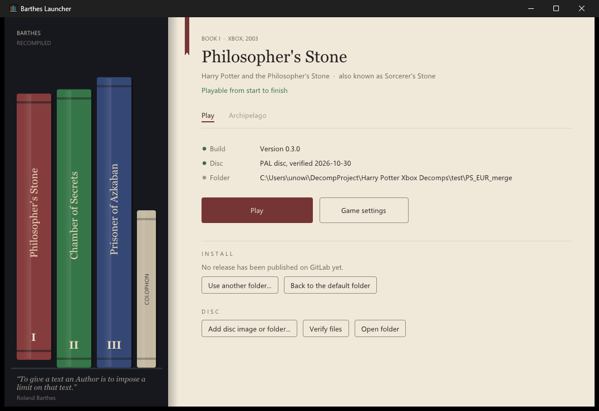

# Barthes Launcher

One home for the Barthes Recompiled ports of the original Xbox Harry Potter games:

| | Game | Port | State |
|---|---|---|---|
| I | Harry Potter and the Philosopher's Stone (Sorcerer's Stone) | [HP1-Recompiled](https://github.com/Barthes-Recompiled/HP1-Recompiled) | 1.0.1: playable, Archipelago |
| II | Harry Potter and the Chamber of Secrets | [HP2-Recompiled](https://github.com/Barthes-Recompiled/HP2-Recompiled) | 1.0.1: playable, Archipelago coming soon |
| III | Harry Potter and the Prisoner of Azkaban | [HP3-Recompiled](https://github.com/Barthes-Recompiled/HP3-Recompiled) | 0.5.1 Beta, Archipelago coming soon |

**Current release: 1.0.1.**

The games stand as books on a shelf. Pick one and its page lets you:

- **Install or update** the port from its GitHub releases (the download is checked against its SHA-256 before anything
  is replaced; your `game\` folder, saves and settings are never touched). A port built per disc edition has a PAL
  and a USA download; the launcher installs the one for the disc you added.
- **Add your disc**: an `.iso`/`.xiso` image is unpacked, an extracted game folder is copied. The launcher reads the
  disc's `default.xbe` first and refuses another game's disc, so a Chamber of Secrets image can't end up in the
  Philosopher's Stone folder.
- **Verify files** against the known-good list of every file on the PAL and NTSC-US discs.
- **Play**, which starts the game itself (`hpps.exe`, `hpcos.exe`, `hppoa.exe`), or **Game settings**, which starts
  it on the port's settings page (resolution, frame rate, controls and the rest; F10 and the game's own Settings menu
  change them too).
- **Archipelago**: a page per game for the multiworld randomizer. Philosopher's Stone connects to a room (server, slot
  name and password; Play starts the game connected). Chamber of Secrets and Prisoner of Azkaban: coming soon.



You need your own copy of the games. Nothing from the games is included here or in any release.

## Setting up

1. Download `barthes_launcher.exe` from the [releases](https://github.com/Barthes-Recompiled/Barthes-Launcher/releases/latest)
   and put it in a folder of its own, for example `C:\Games\Barthes`. It is a single file; nothing is installed into
   Windows.
2. Start it and pick a book from the shelf.
3. Press **Install**. The port's newest release is downloaded from its GitHub repository.
4. Press **Add disc image or folder...** and choose your `.iso` / `.xiso`, or the `default.xbe` of a disc you already
   extracted. The launcher reads the disc's edition and, if the port is built per edition, swaps in the PAL or USA
   build to match.
5. Press **Play**.

Repeat 2 to 5 for each game you own. Updates appear on a book's page when its repository publishes a new release.

```
C:\Games\Barthes\
  barthes_launcher.exe
  barthes.ini          the launcher's choices
  games\hp1\           Philosopher's Stone: hpps.exe, hpps.toml, saves\, shadercache\, game\ (your disc)
  games\hp2\           Chamber of Secrets: hpcos.exe, hpcos.toml, saves\, ...
  games\hp3\           Prisoner of Azkaban: hppoa.exe, hppoa.toml, saves\, ...
```

Each game keeps its settings and saved games inside its own folder (`saves\`, with the game's Xbox disk images in
`saves\xbox`), so a game folder can be backed up or moved as it is. Already have a port unpacked somewhere else?
**Use another folder...** on its page points the launcher at it instead. Each game's exe can also be started on its
own, or from a shortcut, without the launcher.

**Requirements:** Windows 10 (1809) or later, 64-bit. The launcher uses only what Windows ships (WinHTTP, `tar.exe`
for the release zips, Direct3D 11). The games need a DirectX 12 graphics card; see each port's README.

## Archipelago

Philosopher's Stone can be played in an [Archipelago](https://archipelago.gg) multiworld. On its **Archipelago** page,
tick *Play this game in an Archipelago multiworld*, enter the room's server (for example `archipelago.gg:38281`), your
slot name and the password, and press **Play**: the game starts connected. The room's host needs `hpps.apworld` from
the [HP1-Recompiled release](https://github.com/Barthes-Recompiled/HP1-Recompiled/releases/latest). The password is
kept in the game's `saves\archipelago\connection.toml`, never on a command line. Chamber of Secrets and Prisoner of
Azkaban are coming soon.

## Troubleshooting

| Problem | What to do |
|---|---|
| "No release yet" on a book's page | The launcher couldn't get the release list from GitHub. Check your connection, or a firewall blocking `barthes_launcher.exe`, and try again later (GitHub limits how often it is asked). |
| The launcher refuses my disc | It is another game's disc, or not an Xbox disc image. Each book only takes its own game. |
| The game says it is the wrong disc | Add the disc on the game's page (not by copying files into `game\` yourself), so the launcher installs the build for that disc's edition. |
| A game crashes or loses sound in one place | Press **Verify files** (Philosopher's Stone, Chamber of Secrets) to find damaged disc files, then add your disc again. |
| The game won't start | Update your graphics driver (DirectX 12 is required), then see the troubleshooting section of that game's README. |
| Play does nothing | The game may already be running (check the taskbar): only one copy of each game runs at a time. |

Problems and questions go to the issues of [this repository](https://github.com/Barthes-Recompiled/Barthes-Launcher/issues)
or of the game's own.

## Building

MSYS2 UCRT64, the same toolchain as the games:

```sh
pacman -S --needed mingw-w64-ucrt-x86_64-{gcc,cmake,ninja}
cmake -S . -B build -G Ninja -DCMAKE_BUILD_TYPE=Release
cmake --build build
```

`tools/package.sh` builds the release zip and its `.sha256` into `dist/`. For testing, the launcher takes
`--page <hp1|hp2|hp3|colophon>`, `--tab archipelago`, `--verify 1`, `--import <iso or default.xbe>`, `--install 1`
and `--play 1`, and `barthes.ini` takes `release_project = owner/repo` in a game's section to install from
another GitHub repository (a fork, a test channel).

How a game repo publishes a release the launcher can install: [docs/releases.md](docs/releases.md).

## Thanks

**MiddleDucky**, above all. Their Xbox ports of
[Philosopher's Stone](https://github.com/MiddleDucky/HP-PS-Xbox-Recomp) and
[Chamber of Secrets](https://github.com/MiddleDucky/HP-COS-Xbox-Recomp) are the ground every book on this shelf stands
on: the recompiler work, the renderer, the audio and input, and the fixes the Prisoner of Azkaban port is being built
from. This launcher's disc unpacking (`src/xiso.c`) and file checks (`src/gamecheck.c`, `src/lists/`) are adapted
from their code (MIT), put to work for all three games at once; the rest of the launcher is our own. None of this
exists without them. Thank you, MiddleDucky, truly and enormously. If you enjoy these ports, go and star their
repositories.

**Athelas**, whose launcher showed what a good home for a recomp can be, and set the bar for what this one should do.
The look here is our own; the inspiration for doing it properly is theirs.

[Dear ImGui](https://github.com/ocornut/imgui) by Omar Cornut draws the window.

## Why Barthes

> "To give a text an Author is to impose a limit on that text, to furnish it with a final signified, to close the
> writing."
>
> Roland Barthes, "The Death of the Author" (1967), translated by Stephen Heath

"I named this project after Roland Barthes to express - in whatever way I could - that my affection for these games has nothing to do with the author of the books on which they are based."

## License

MIT, see [LICENSE](LICENSE). The files taken from MiddleDucky's ports keep their MIT notice, and Dear ImGui keeps its
own (`third_party/imgui/LICENSE.txt`). The games and everything on their discs belong to their owners.
